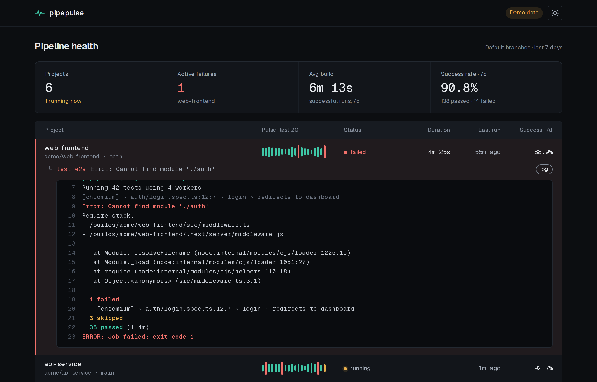
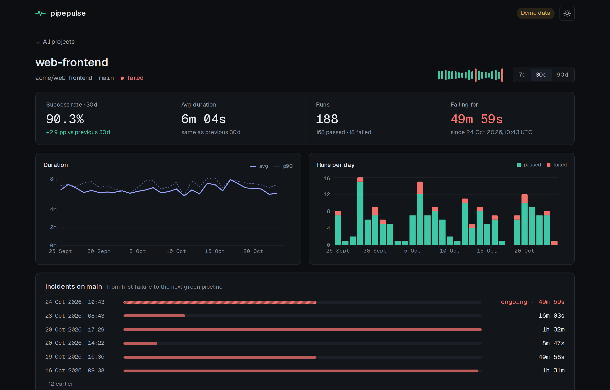
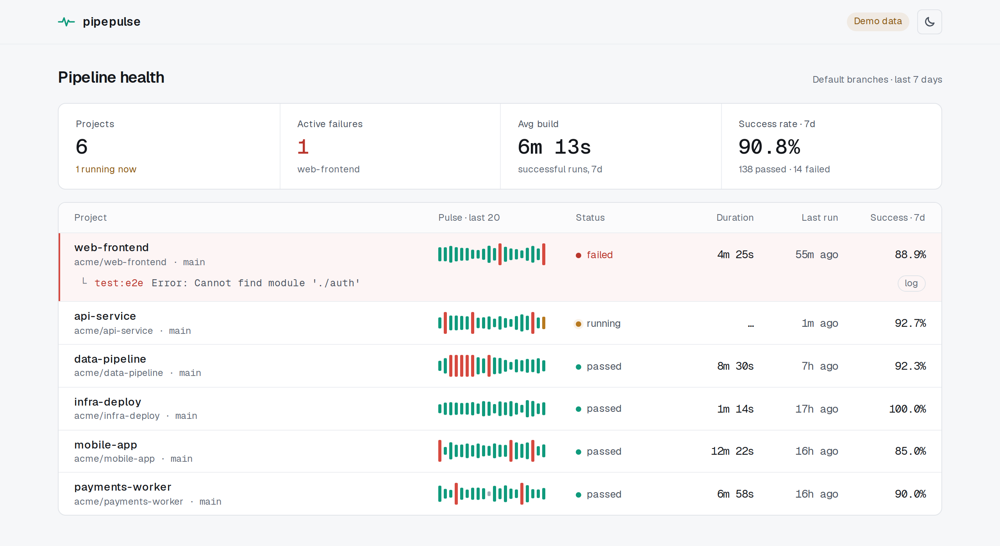

# pipepulse

**Pipeline health dashboard for GitLab.**

Monitor multiple GitLab projects from a single view — with history, trends, and inline failure logs.


[](https://github.com/morveusz93/pipepulse/actions/workflows/ci.yml)

**Live demo: [pipepulse.morv.dev](https://pipepulse.morv.dev)** (generated sample data, no GitLab token needed)



<details>
<summary>Project view and light theme</summary>





</details>

---

## Why

Most CI dashboards show only the current state. pipepulse stores pipeline history in Postgres and surfaces:

- **Trends** — is your build getting slower? fail rate rising over 7/30 days?
- **MTTR** — time between a failure and the next success on the same branch
- **Inline failure logs** — expand a failed job's last N lines without leaving the dashboard
- **Pulse** — a per-project EKG-style sparkline of the last 20 runs (color = result, height = duration)

Inspired by [larscom/gitlab-ci-dashboard](https://github.com/larscom/gitlab-ci-dashboard) and [ci-dashboard/gitlab-ci-dashboard](https://github.com/ci-dashboard/gitlab-ci-dashboard). pipepulse adds persistent history, trend analytics, and a premium-grade UI.

---

## Stack

| Layer | Tech |
|---|---|
| Backend | Python · FastAPI · async background worker |
| Database | PostgreSQL |
| Frontend | Next.js · TypeScript · Recharts |
| Infra | Docker · Helm (k3s) · GitHub Actions |
| Demo | Vercel (dashboard only, snapshot data) · `pipepulse.morv.dev` |

---

## Features (MVP)

- Connect multiple GitLab projects via API token (`read_api` scope, stored encrypted)
- Aggregate pipeline stats: count, success/fail rate, avg duration
- Per-project view: trend chart, fail rate, MTTR
- List of recent failures with inline job log preview
- Filter/sort (e.g. failed only, by project, by date)
- **Demo mode** — works out of the box with seed data, no token required

---

## Design

- Monospace font for data (numbers, durations, SHAs, timestamps) — sans for labels and nav
- Color carries meaning: teal = success · coral = failure · amber = running
- Dense list layout (not cards) — more dashboard, less landing page
- Signature element: **pulse bar** — a row of thin stripes per project, each stripe = one pipeline run
- Light/dark theme (dark by default); keyboard-accessible; `prefers-reduced-motion` respected

```
┌─────────────────────────────────────────────────────────────────┐
│  Projects: 6   Active failures: 2   Avg build: 4m 12s   ✓ 94%  │
├────────────────┬──────────────────────┬────────────┬────────────┤
│ Project        │ Pulse (last 20)      │ Status     │ Duration   │
├────────────────┼──────────────────────┼────────────┼────────────┤
│ api-service    │ ▁▃▂█▂▁▃▂▁▁▂▃▁▂█▂▁▃▂▁│ ✓ success  │ 3m 48s     │
│ web-frontend   │ ▂▁▃█▁▂▃▁▂▃▁▂▁▃▁▂▁▃▁▂│ ✗ failed   │ 6m 02s     │  ← expanded
│   └─ test:e2e  │ Error: Cannot find module './auth' ...         │
│ infra-deploy   │ ▁▁▂▁▃▁▁▂▁▃▁▁▂▁▁▃▁▁▂▁│ ✓ success  │ 1m 15s     │
└────────────────┴──────────────────────┴────────────┴────────────┘
```

---

## Roadmap

- [x] Project spec & architecture decisions
- [x] Repo structure, docker-compose (api + postgres)
- [x] GitLab API client (projects, pipelines, jobs, trace)
- [x] Data model + migrations
- [x] Background polling service
- [x] API endpoints: projects, pipelines, aggregates, job log
- [x] Token encryption (Fernet)
- [x] Seed data for demo mode
- [x] Frontend: design tokens, dark/light theme
- [x] Pulse component
- [x] Summary bar + project list
- [x] Per-project view (trend chart, fail rate, MTTR)
- [x] Inline log viewer
- [x] Pipeline filters, sorting, pagination
- [ ] Login + connection management UI (self-hosted)
- [x] Dockerfiles + Helm chart (tested on a local k3s cluster)
- [x] CI (GitHub Actions)
- [x] Frontend-only demo mode (snapshot of the real API)
- [x] Live demo on [pipepulse.morv.dev](https://pipepulse.morv.dev)
- [ ] Prometheus metrics (optional)

---

## Demo

The [public demo](https://pipepulse.morv.dev) is the dashboard alone, deployed on Vercel with `PIPEPULSE_DEMO=true`. It needs
no backend or database: it serves `web/src/demo/snapshot.json`, a snapshot recorded from the
real API on generated data (6 projects, 60 days of history). Timestamps are shifted to "now" on
every request, so the demo never looks stale.

Regenerate the snapshot after changing the API or the demo data:

```bash
docker compose up -d postgres migrate
cd api && uv run python -m pipepulse.seed.snapshot ../web/src/demo/snapshot.json
```

To run pipepulse for real against your GitLab, use docker-compose (below) or the
[Kubernetes guide](deploy/README.md).

## Local development

Prerequisites: [Docker](https://docs.docker.com/engine/install/) with the Compose plugin. For working on the API outside containers also [uv](https://docs.astral.sh/uv/). Postgres runs in Docker, so you don't need to install it locally.

```bash
cp .env.example .env
docker compose up --build        # everything: dashboard on :3000, API on :8000
open http://localhost:3000
```

API without Docker (needs a reachable Postgres, see `PIPEPULSE_DATABASE_URL`):

```bash
cd api
uv sync
uv run alembic upgrade head
uv run uvicorn pipepulse.main:app --reload
uv run pytest
```

Dashboard (Next.js, needs the API running):

```bash
cd web
npm install
npm run dev                      # http://localhost:3000
npm test                         # unit tests (ANSI log parser, formatting)
```

DB-backed tests use a separate database. Create it once and they'll run against it, otherwise they're skipped:

```bash
docker compose exec postgres psql -U pipepulse -c 'CREATE DATABASE pipepulse_test'
```

### Connecting your own GitLab (self-hosted)

Set in `.env`: `PIPEPULSE_DEMO_MODE=false`, `PIPEPULSE_ENCRYPTION_KEY` and `PIPEPULSE_ADMIN_PASSWORD`. Log in with `POST /api/auth/login`, then add a connection with a token that has the **`read_api`** scope (the full `api` scope works but isn't needed). Tokens are validated against GitLab, stored encrypted and only ever shown masked. Add projects to the connection and the worker backfills their history on its next cycle.

API docs: http://localhost:8000/api/docs

Repo layout: `api/` (FastAPI + poller), `web/` (Next.js dashboard), `deploy/` (Helm chart and [self-hosting guide](deploy/README.md)).

---

## License

MIT
